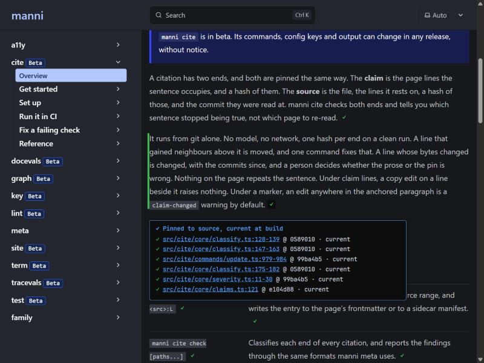

# 0095: Provenance on the live site, with `manni site annotate`

- **Status:** Proposed
- **Serves:** Two people, three journeys, and one reader no persona covers.
  - Maya · M5, "Pin a claim and catch it going stale". Her pins stop at CI
    today. With this change the reader sees which sentences rest on code.
  - Maya · M26, "Run the docs site locally". She previews the marks on the
    same site she already serves.
  - Devin · D13, "Publish the graph for retrieval". What ships is what passed,
    and now the page says so.
  - The reader of the published site. No persona in
    `docs/content-strategy/personas.md` is a reader. The acceptance checklist
    adds journey M28 for Maya, written from the reader's side.
- **Depends on:** Five earlier proposals.
  - [0090](0090-served-passages-carry-their-proof.md) is the provenance
    record and `graph export provenance`. This proposal reads that artifact
    and renders its records. It defines no record of its own.
  - [0044](0044-citations-and-drift.md) is the pin. A claim is page lines
    and a hash, and a source is file lines, a hash and a commit.
  - [0082](0082-a-site-domain-runs-the-docs-site.md) is the site domain this
    adds a verb to, with its framework table.
  - [0069](0069-merge-safe-stamps.md) and
    [0072](0072-derived-dates-are-utc-days.md) are the two dates a record
    carries, as UTC days.
  - [0045](0045-family-encryption-key.md) is why an encrypted source never
    reaches a reader as a path.
- **Relates to:** [0051](0051-graph-domain.md), the graph. Stress test 4
  says why the browser does not load the graph runtime.
- **Supersedes in part:** 0082's known limit "Default output directories
  only". The new `site.out` key names the output, and the built-in server
  reads it too.
- **Proposes a change to:** 0090's record. One field joins each pin item.
  Decision 5 says which, and why.
- **Touches:** `src/site/` (a verb, the join, the renderer, and the framework
  table's `out` and route columns), a package export
  `@hawkeyexl/manni/site/rehype`, the site domain's reference pages and
  `docs/content-strategy/cujs.md`

## Problem

manni makes a page trustworthy in CI. `cite check` proves each pinned
sentence against its source. `meta derive` stamps when a page was created and
updated. `docevals run` grades the page against its assertions. None of that
reaches the person reading the published page.

0090 gathers those facts into one record per passage, for an agent that
retrieves the passage. A person reading the page in a browser still gets
nothing.

This repository's own site shows the gap. Its 252 pages carry 4,199 pins, and
every one was current at commit `26dad159`. A reader of
`hawkeyexl.github.io/manni/cite/` sees the same prose as a page with no pins at
all. Nothing tells a proven sentence from the rest.

| Who | What they hit today | Cost |
|---|---|---|
| A reader | No sign of which sentences rest on code, or when anyone checked. | They trust every sentence equally, or none. |
| Maya · M5 | Her pins are invisible past CI. | The work has no reader-facing payoff. |
| Devin · D13 | The site ships with no record of which checks it passed. | An auditor has to rerun the checks to know. |

## Decision

### 1. Everything is computed at build, and the browser only renders

Two steps run in CI, after the checks that gate.

1. `manni graph export provenance` (0090) writes `provenance.json`. It holds
   each passage's pins, its page's dates and the page's eval verdicts.
2. `manni site annotate`, the new verb, runs after the framework's build. It
   reads `provenance.json` and the built HTML. It changes nothing in the
   sources.

Annotate does three things.

1. It joins each pin's claim to the blocks of the built HTML (decision 2).
2. It writes an inline mark on each joined block, and one summary mark per
   page.
3. It writes each page's records into the page as JSON, and adds one
   stylesheet and one script under `_manni/`.

The browser loads no data and runs no check. The marks are static HTML, and
each popover uses the native `popover` attribute. A click, Enter or Space opens
one, and Escape closes it, with no script. The script adds one thing, which is
opening a popover on hover. With scripts off, every mark still works.

### 2. A claim joins its passage by source lines first, then by text

A 0090 record covers a section, which is too coarse for a mark. Each pin item
inside it names the body lines its claim occupies now. Annotate adds the
page's frontmatter length to get file lines, as cite's `toFileLines` does.
The join then carries those lines to the built HTML in two steps.

| Step | How a block is found | When it applies |
|---|---|---|
| Lines | The block carries a `data-manni-src` stamp whose range overlaps the claim's file lines. | The framework renders through unified and loads `@hawkeyexl/manni/site/rehype`. |
| Text | The claim's lines, rendered to plain text, match the text of a run of adjacent blocks. | No stamped block overlaps the claim. Only a single candidate run counts. |

Texts match when they are equal, or when one holds the other. A block text
inside a longer claim counts only at 12 characters or more. A claim found by neither
step, or by text in two places, is **not placed**. It is listed in the page's
summary popover rather than guessed. Annotate never marks a passage it cannot
tie to the claim.

The stamp is `data-manni-src="<page file>:<start>-<end>"`. A rehype plugin of
ten lines writes it, from the line positions every unified pipeline already
carries. It names the file, so a partial imported into a page joins to its
own pins. Annotate removes every stamp after the join, so no `data-manni-src`
reaches the deployed site.

The prototype under stress test 1 measured both steps on this repository's
site.

| Join | Claims placed | Agreement with the line stamps |
|---|---|---|
| Lines alone | 3,960 of 4,199 (94.3%) | by definition |
| Lines, then a single text run | 4,126 of 4,199 (98.3%) | 99.4% for single runs |
| Text alone, single runs only | about 3,316 of 4,199 (79%) | 99.4% |
| Text alone, document order breaking ties | 4,124 of 4,199 (98.2%) | 91.5% where it broke a tie |

The fourth row is why ties are never broken. One reader in twelve would see a
wrong proof on those passages, and a wrong proof is worse than none.

### 3. Sites other than Starlight

Every framework 0082 detects either builds static HTML or has no local build.

| Framework | Output (`out`) | Route for an unstamped page | Lines step |
|---|---|---|---|
| Starlight | `dist` | `<path>/index.html` | rehype plugin |
| Docusaurus | `build` | `docs/<path>/index.html` | rehype plugin |
| Nextra, Fumadocs | `out` | `<path>.html` | rehype plugin |
| Rspress | `doc_build` | `<path>.html` | rehype plugin |
| VitePress | `.vitepress/dist` | `<path>.html` | none, text only |
| MkDocs, Zensical | `site` | `<path>/index.html` | none, text only |
| Sphinx | `<src>/_build/html` | `<path>.html` | none, text only |
| Hugo | `public` | `<path>/index.html` | none, text only |
| Jekyll | `_site` | `<path>.html` | none, text only |
| Mintlify, Fern | none | none | none |

`<path>` is the page's path below the framework's content directory, without
its extension. An `index` page maps to its directory. A stamped page needs no
route, because the stamp names its file.

Nextra and Fumadocs write static pages only under `output: "export"`. A
server build has no HTML to annotate, and annotate says so. Mintlify and Fern
build on their own hosts, so there is nothing local to annotate.

A text-only framework gets the second step alone, which placed 79% of claims
here. Stress test 6 records what that costs.

### 4. What a reader sees

Each placed passage gets one inline mark after its last word. A summary mark
follows the page's `<h1>`. The glyph carries the meaning, and the colour
repeats it.

| Mark | When | Popover heading |
|---|---|---|
| `✓` green | No pin on the passage has an `error` finding. | `Pinned to source. Current at build 26dad15.` |
| `✗` red | At least one pin on the passage has an `error` finding. | `A source changed after it was pinned. Checked at build 26dad15.` |
| none | The passage has no pin. | none |

A finding's severity is the one the record carries, which cite resolves from
`cite.severity`. A `source-moved` warning keeps its `✓`, and the popover names
the rule.

A passage popover lists one line per pin. A pin with no findings reads
`current`, and a pin with findings names each rule.

```text
✓ src/cite/core/classify.ts:128-139 · current
✗ src/upload.ts:102-104 · source-changed
```

The path links to the source lines at the pin's commit. The link is built from
the `origin` remote when it is GitHub or GitLab, and is absent otherwise. An
encrypted source shows as `a private source`, with no path, lines or link.

The summary popover reads like this.

```text
✓ 12 passages pinned to source
Checked at build 26dad15.
Created 2026-09-12. Updated 2026-10-20.
Evals: 2 of 2 pass at build.
3 citations rest on this page but on no single passage.
```

The date line names only the days the record holds. The evals line appears
only when the record carries verdicts, and names any eval that did not pass.

The palette follows `docs/content-strategy/design.md`. Green and red here are
the product's own meaning, as in the terminal, not chrome. The accent blue
draws the popover border and the links.

| Pair | Ratio | WCAG 2.2 AA |
|---|---|---|
| `#3fb950` on `#171717` | 7.06 | passes |
| `#f85149` on `#171717` | 5.35 | passes |
| `#1a7f37` on `#ffffff` | 5.08 | passes |
| `#cf222e` on `#ffffff` | 5.36 | passes |
| `#1a7f37` on `#f6f8fa` | 4.77 | passes |

The mark sits inline rather than in the margin. The prototype hung it in the
left gutter first. At 1024px Starlight's gutter is 12px, which clipped the
mark. An inline mark needs no gutter on any theme.



### 5. The record is 0090's, with one proposed field

Annotate defines no record. Every mark renders the records
`provenance.json` holds, joined as 0090's `provenanceFor` joins them. Each
page carries its records in one island, so a machine reading the page gets
the same record an agent gets over MCP.

```html
<script type="application/json" id="manni-provenance">[ { "node": "…", "page": "…", "lines": "…", "commit": "…", "worktree": "clean", "pins": { … }, "dates": { … }, "evals": { … } } ]</script>
```

The island holds every record whose `page` is this page, unchanged and in
`lines` order. `<script type="application/json">` never runs, so a strict
content security policy allows it.

The live site needs one fact the record first lacked. 0090 now carries it:
each `pins.items[]` entry has `commit`.

| field | type | meaning |
|---|---|---|
| `pins.items[].commit` | 40 hex | The source end's recorded `commit-sha`, as the citation entry holds it. |

The record's top-level `commit` is the docs checkout. It is the wrong commit
for a link in two cases. A source under `cite.root` in another repository has
no lines at that commit. And a pin with a `source-changed` finding should link
the lines the sentence was pinned to, which only the pin's own commit has. The
field is additive, so 0090's `version` stays `1` if it lands before 0090
ships.

The record leaves out `last-reviewed`, because computing it needs the network.
So the summary names no review date. That follows 0090's rule, and this
proposal asks no change to it.

### 6. The command line

```text
manni site annotate [options] [dir]

Arguments:
  dir                     the site's directory (default: site.dir, else found by search)

Options:
  --out <dir>             the built site to annotate (default: site.out, else the framework's output)
  --provenance <file>     a graph export provenance file (default: provenance.json beside graph.out)
  -f, --format <format>   output: pretty | json (default: pretty)
  -c, --config <file>     path to a manni config file
  -h, --help              display help for command
```

`[dir]`, `-c` and the search follow `site build` exactly. The pages annotated
are the pages `provenance.json` names. Eval verdicts come in through
`graph export provenance --evals`, so annotate takes no evals flag.

`site build` and `site preview` run annotate after a successful build when
`site.annotate.after-build` is `true`. `preview` serves the annotated output.
`site start` never annotates, because a dev server writes no output.

### 7. Config

Before, `site:` has `dir` and `commands`. After, two keys join, and every key
stays optional.

```yaml
# Before
site:
  dir: docs
  commands:
    build: pnpm build
```

```yaml
# After
site:
  dir: docs
  commands:
    build: pnpm build

  # string. The built site, relative to dir. Default: the framework's output
  # (decision 3). Read by annotate and by preview's built-in server.
  out: dist

  annotate:
    # boolean. Default: false. When true, `site build` and `site preview`
    # run `site annotate` after a successful build.
    after-build: true
```

| Key | Type | Default | Required | Meaning |
|---|---|---|---|---|
| `site.out` | string | the framework's output | no | The built site, relative to `site.dir`. |
| `site.annotate.after-build` | boolean | `false` | no | `build` and `preview` annotate after the build. |

The eval report stays where 0090 puts it, under
`graph.export.provenance.evals`.

The framework's own config needs one line for the lines step. In this
repository that line is in `docs/astro.config.mjs`.

```js
import manniLines from "@hawkeyexl/manni/site/rehype";
// ...
markdown: { rehypePlugins: [rehypeFocusableTables, manniLines] },
```

### 8. Messages and exit codes

Annotate is not a gate. `cite check` is. So annotate exits `0` whatever the
pins say, and `2` when it cannot run. It never exits `1`.

| When | Stream | Line | Exit |
|---|---|---|---|
| Before the join | stderr | `manni: Starlight in docs/. Annotating docs/dist from .manni/graph/provenance.json.` | n/a |
| Success | stdout | `docs/dist: 251 pages annotated. 4126 of 4199 pins placed, 73 listed on their page only.` | 0 |
| Unplaced, repeated text | stdout | `  cite/reference/citations/index.html: 3 pins not placed, because their text appears twice: a, b, c.` | 0 |
| Unplaced, no block | stdout | `  cite/fix/index.html: 1 pin not placed, because no block holds its text: d.` | 0 |
| A page with no built page | stdout | `  docs/src/content/docs/x.mdx: no built page at docs/dist/x/index.html.` | 0 |
| A passage marked `✗` | stdout | `  cite/index.html: 1 passage marked ✗, because a source changed: fetch-timeout.` | 0 |
| A unified framework with no stamps | stderr | `manni: docs/dist carries no line stamps, so passages are placed by text alone. Add @hawkeyexl/manni/site/rehype to the framework's rehype plugins.` | n/a |
| A modified worktree at export | stderr | `manni: .manni/graph/provenance.json was exported from a modified worktree, so some marks describe uncommitted text.` | n/a |
| No output directory | stderr | `manni: no built site at docs/dist. Run manni site build first, or pass --out.` | 2 |
| Nextra or Fumadocs server build | stderr | `manni: docs/out does not exist. Nextra writes static pages only with output: "export" in next.config.` | 2 |
| Mintlify or Fern | stderr | `manni: Mintlify builds on its own host, so there is no local output to annotate.` | 2 |
| No provenance file | stderr | `manni: .manni/graph/provenance.json does not exist. Run manni graph export provenance first.` | 2 |
| Not a provenance file | stderr | `manni: notes.json is not a graph export provenance file.` | 2 |
| A file from another commit | stderr | `manni: .manni/graph/provenance.json describes 1a2b3c4, but the checkout is at 26dad15. Run manni graph export provenance.` | 2 |
| No page has a built page | stderr | `manni: none of 252 pages has a built page in docs/dist. Check --out or site.out.` | 2 |
| A build failed under `after-build` | stderr | `manni: npm run build exited with code 1.` This is 0082's line, and annotate does not run. | 2 |
| An unknown key | stderr | ``manni.config.yaml: `site.annotate:` has unknown key "marks". Supported keys: after-build.`` | 2 |
| A wrong type | stderr | `manni.config.yaml: site.annotate.after-build must be a boolean.` | 2 |

### 9. Output shapes

`-f json` prints one object.

```json
{
  "out": "docs/dist",
  "framework": "Starlight",
  "provenance": ".manni/graph/provenance.json",
  "stamped": true,
  "summary": { "pages": 252, "annotated": 251, "pins": 4199, "placed": 4126, "unplaced": 73, "drifted": 0 },
  "pages": [
    {
      "file": "docs/src/content/docs/cite/reference/citations.mdx",
      "html": "docs/dist/cite/reference/citations/index.html",
      "passages": 41,
      "placed": 88,
      "unplaced": [{ "id": "severity-notice-sarif-note", "reason": "ambiguous" }]
    }
  ],
  "missing": ["docs/src/content/docs/x.mdx"]
}
```

`reason` is `ambiguous` or `no-match`. `drifted` counts passages marked `✗`.
An unplaced pin with no `id` is named by its claim lines, as `"claim": "47"`.

Each annotated HTML page changes in four places. Each joined block gains
`data-manni-proof="<n>"` and an inline `<button class="manni-mark"
popovertarget="manni-proof-<n>">`. The popovers and the island are appended
to `<body>`. The `<head>` gains a stylesheet link and a deferred script, both
relative to `_manni/`. Running annotate twice gives the same bytes as once.

### 10. The ladder

In this repository unless noted.

```text
# 1. Minimal: export the records, build however you build, then annotate
$ manni graph build && manni graph export provenance
$ (cd docs && npm run build)
$ manni site annotate
manni: Starlight in docs/. Annotating docs/dist from .manni/graph/provenance.json.
docs/dist: 251 pages annotated. 4126 of 4199 pins placed, 73 listed on their page only.
                                                        # exit 0

# 2. From config: site.annotate.after-build: true
$ manni site build
manni: Starlight in docs/. Running npm run build
manni: Starlight in docs/. Annotating docs/dist from .manni/graph/provenance.json.
docs/dist: 251 pages annotated. 4126 of 4199 pins placed, 73 listed on their page only.

# 3. See it before it ships
$ manni site preview                                    # builds, annotates, serves

# 4. With eval verdicts, deterministic only, as CI runs them
$ manni docevals run --deterministic-only -f json > .manni/evals.json
$ manni graph export provenance --evals .manni/evals.json
$ manni site annotate

# 5. Scripting
$ manni site annotate -f json | jq .summary.unplaced
73

# 6. CI: gate, export, then annotate what passed, then deploy
- run: npx @hawkeyexl/manni cite check -f github
- run: npx @hawkeyexl/manni graph build
- run: npx @hawkeyexl/manni graph export provenance
- run: npx @hawkeyexl/manni site build                  # after-build: true
- uses: actions/upload-pages-artifact@v3
  with: { path: docs/dist }

# 7. An MkDocs repository, text join only, and no rehype hint
$ manni site annotate
manni: MkDocs in docs/. Annotating site from .manni/graph/provenance.json.
site: 40 pages annotated. 246 of 310 pins placed, 64 listed on their page only.

# 8. Everything at once
$ manni site annotate docs -c ci/manni.config.yaml --out docs/dist \
    --provenance .manni/graph/provenance.json -f json

# 9. Usage errors, all exit 2
$ manni site annotate                                   # before any build
manni: no built site at docs/dist. Run manni site build first, or pass --out.
$ manni site annotate                                   # before graph export provenance
manni: .manni/graph/provenance.json does not exist. Run manni graph export provenance first.
$ manni site annotate                                   # after a new commit
manni: .manni/graph/provenance.json describes 1a2b3c4, but the checkout is at 26dad15. Run manni graph export provenance.
$ manni site annotate                                   # a Mintlify repository
manni: Mintlify builds on its own host, so there is no local output to annotate.
```

The MkDocs numbers in rung 7 are illustrative.

### 11. Programmatic API

`src/index.ts` does not change. One package export is added.

| Export | What it is |
|---|---|
| `@hawkeyexl/manni/site/rehype` | The default export is the rehype plugin that writes `data-manni-src` stamps. It imports nothing from `node:`. |

## Known limits

- **The graph must be set up.** The records come from `graph export
  provenance`, so a site with pins and no `graph:` section gets no marks.
  Annotate says which command to run.
- **Routes follow conventions.** A page with a custom slug or permalink has
  no route in decision 3. It gets marks only when stamped, and is otherwise
  listed as missing.
- **Text-only frameworks place fewer claims.** VitePress, MkDocs, Zensical,
  Sphinx, Hugo and Jekyll place about four claims in five on a site like this
  one.
- **Code blocks need the text step.** Expressive Code renders its own `<pre>`
  and drops the line positions. 156 of the 166 claims the text step placed
  here were code blocks.
- **Hover needs the script.** The native popover opens on click, Enter or
  Space. Opening on hover is the one thing the script adds.

## Stress test

### 1. Can this repository's site join paragraphs to pins at build?

Yes. A throwaway prototype outside `src/` ran at `26dad159`, before 0090 had
a draft. It read claim lines from `cite check -f json`, which are the same
lines a 0090 pin item carries, shifted by the frontmatter. It covered 252
pages and 4,199 claims. It parsed the built `docs/dist` with parse5, and
rendered each claim's lines to text with `mdast-util-from-markdown`. A
ten-line rehype plugin stamped block elements with their source lines.

Lines alone placed 94.3% of claims. Lines with a single text run placed
98.3%. The text step agreed with the line stamps on 99.4% of single runs.
Where text had to break a tie by document order, it agreed on only 91.5%.
Those ties are left unplaced (decision 2).

The misses fall into three groups. One is code blocks, whose positions
Expressive Code drops. Another is table rows, whose cell text repeats across
tables. The last is claims that start or end mid-paragraph, whose text is no
block's text.

### 2. Why not run the join in the browser?

The join needs the page source, which the browser does not have. It is also
the step that can be wrong. Running it in CI puts its count in a log a
maintainer reads, and not in a reader's console.

### 3. Why static HTML rather than a script that reads the island?

The prototype used a script. Static marks work with scripts off and under a
strict content security policy. The native `popover` attribute gives click,
keyboard and Escape for free. The island stays, for machines.

### 4. Why not load the graph runtime?

`@hawkeyexl/manni/graph/runtime` reads a whole graph and `provenance.json`.
The marks need one page's records, which the page already carries. Loading
the runtime adds a download that answers nothing the island does not. A site
that wants search already loads the runtime, and the records it serves are
the same ones.

### 5. Why a new verb rather than a flag on `site build`?

Many sites never build through manni. This repository's own Docs workflow
runs `npm run build` in `docs/`. A verb that takes the output directory works
after any build. `site.annotate.after-build` covers the sites that do build
through manni, with no second command.

### 6. Is text alone worth shipping for MkDocs, Hugo and the rest?

Yes, with the tie rule. It places four claims in five, and 99.4% of those are
right. A missing mark costs a reader nothing they have today. A wrong mark
costs the trust the feature exists to build. The listed claims still appear
in the page summary.

### 7. Should an `error` finding stop annotate?

No. A repository that gates runs `cite check` first, and an `error` never
reaches annotate. A repository that does not gate still gets an honest page.
The reader sees `✗` where a source changed, which is the truth at build.

### 8. Does a record leak what encryption hides?

No more than the repository already does. 0090 keeps an encrypted source as
its ciphertext token, which the public citation manifest already holds.
Annotate renders that token as "a private source", with no link.

### 9. Do the stamps leak repository paths?

Only if annotate does not run. Annotate strips every `data-manni-src`. A site
that loads the plugin and never annotates ships stamps naming page files.
Those names are already public in a public docs repository. The reference
page says to load the plugin only where annotate runs.

### 10. Why refuse a file from another commit?

The marks would describe text that may no longer be on the page. A reader
cannot tell, and the build can. Exporting again costs one command.

## Rejected

- **A record of this proposal's own.** The first draft defined one, before
  0090 existed. Two shapes for one fact is the parity break CLAUDE.md
  forbids, so the site reads 0090's.
- **Running cite in process.** 0090's export already runs cite's classifier
  once per build. Running it twice could give two answers for one commit.
- **Marks in the left margin.** At 1024px Starlight leaves a 12px gutter, and
  the prototype's margin mark was clipped. Other themes vary more.
- **Document order to break text ties.** It placed 91.5% correctly, which is
  one wrong proof in twelve.
- **A config key per mark style.** The marks have one design. A key would be
  a second surface nobody asked for.

## Open questions

1. **The pin commit.** Answered: 0090 now takes `pins.items[].commit`
   (decision 5). Without it, a link goes to the docs checkout's commit, which is wrong for
   a cross-repository source.
2. **Authorship.** 0046's `provenance` pins the lines a model wrote. Should
   0090's record carry that too, so a reader sees which passages a model
   drafted?
3. **Route overrides.** Is a custom slug common enough to warrant a route
   map, or does the rehype stamp cover the frameworks that need one?
4. **VitePress.** It renders through markdown-it, whose tokens carry line
   maps. A markdown-it stamp plugin would give it the lines step. Is that
   worth a second export?
5. **Pins outside the graph.** A page cite reads but the graph does not gets
   no marks. Should annotate say so per page, or is the `missing` list
   enough?

## Acceptance checklist

- [ ] `src/site/commands/annotate.ts` exists, and `manni site annotate` is
      mounted under `site` with `[dir]`, `--out`, `--provenance`, `-f` and
      `-c`, as decision 6 lists.
- [ ] Annotate reads records through 0090's `parseProvenance` and
      `provenanceFor`, and `src/site/` defines no record type.
- [ ] 0090's pin items carry `commit`, or open question 1 is closed with the
      link built from the record's top-level `commit`.
- [ ] `src/site/core/detect.ts` carries `out` and the route rule for every
      framework in decision 3.
- [ ] `@hawkeyexl/manni/site/rehype` is a package export, and the
      bundle-purity test covers it with no `node:` import.
- [ ] `manni site annotate` on this repository's built site exits 0 and
      places at least 95% of pins, with the stamp plugin loaded.
- [ ] A claim whose text matches two block runs is never marked, and is
      listed with reason `ambiguous`.
- [ ] No `data-manni-src` attribute remains in any annotated page.
- [ ] Running annotate twice leaves every file byte-identical to one run.
- [ ] The island on each page holds exactly that page's 0090 records.
- [ ] A passage with an `error` finding is marked `✗`, and annotate still
      exits 0.
- [ ] An encrypted source renders as "a private source", with no link.
- [ ] Each message in decision 8 is pinned by a test, with its stream and exit
      code.
- [ ] The rehype hint appears only for Starlight, Docusaurus, Nextra,
      Fumadocs and Rspress, and never for a text-only framework.
- [ ] A `provenance.json` from another commit exits 2 with its line.
- [ ] `-f json` prints the object of decision 9, and `reason` is `ambiguous`
      or `no-match`.
- [ ] `site.out` and `site.annotate.after-build` parse as decision 7 says.
      An unknown key or a wrong type exits 2 with its line.
- [ ] `manni site build` and `site preview` annotate only when `after-build`
      is `true`, and only after a successful build.
- [ ] Preview's built-in server reads `site.out`, and 0082's Status line reads
      `Superseded in part by 0095`.
- [ ] Every mark is a `<button>` with `popovertarget`, and
      `manni a11y check` passes on the annotated site.
- [ ] The light and dark colours of decision 4 are the ones shipped, and
      each measures 4.5:1 or more on its background.
- [ ] Fixtures under `test/site/fixtures/` cover a stamped page, an unstamped
      page, a repeated table row and an encrypted source.
- [ ] `docs/src/content/docs/site/reference/cli.mdx` documents `annotate`,
      and `docs:check-cli` verifies it.
- [ ] A site journey page explains annotate for Maya, and
      `docs/content-strategy/cujs.md` gains M28, "Show readers which sentences
      are proven".
- [ ] `docs/astro.config.mjs` loads the plugin, and the Docs workflow exports
      provenance and annotates before it deploys.
- [ ] This proposal's Status line reads `Implemented (#NNN)`, and the
      proposals index lists 0095.
- [ ] A `feat(site):` demo video under `media/` shows a page before and after
      `manni site annotate`, with captions.

## Consequences

- Good, because a reader can tell a proven sentence from the rest.
- Good, because the check that ran in CI is what the page shows. Nothing is
  rerun in a browser.
- Good, because an agent over MCP and a reader in a browser get one record.
- Bad, because the site's HTML changes after its framework built it. A
  framework that hashes its own output for caching sees new bytes.
- Bad, because a site needs the graph set up before it gets marks.
- Bad, because a text-only framework shows marks on fewer passages than a
  unified one.
